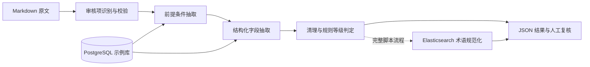

# MedRuleExtractor

面向药品说明书的多阶段 LLM 规则抽取与人工复核工具。将 Markdown 原文逐步转换为审核项、前提条件和结构化字段，并提供 Vue 界面查看、编辑各阶段结果。

这是从协作开发项目整理的公开版本，保留核心源码与提示词，移除了真实凭据、内部服务地址、运行日志和业务数据。贡献者见 [AUTHORS.md](AUTHORS.md)。

## 核心能力

- **分阶段抽取**：原文切分 → 审核项识别与校验 → 前提条件抽取 → 字段抽取 → 清理、合并和规则等级判定。
- **检索参考示例**：根据阶段、类型、标签从 PostgreSQL 检索 few-shot 示例，拼接到提示词。这里采用元数据条件查询，不是向量检索。
- **术语规范化**：完整脚本流程额外通过 Elasticsearch 检索药品及给药途径字典，辅助字段规范化。
- **人工复核**：Vue 3 + TypeScript 界面支持文件浏览、阶段结果编辑与差异记录；WebSocket 展示脚本执行日志。
- **服务接口**：FastAPI 提供分阶段接口及 `/full_pipeline`，使用 `asyncio` 和线程调用同步模型 SDK。

## 实现范围

| 入口 | 处理范围 | 主要依赖 |
| --- | --- | --- |
| `main.py` | Phase 1–3：审核项、条件、结构化字段与后处理 | OpenAI 兼容接口、PostgreSQL |
| `extract/run_pipeline.py` | Phase 1–4：增加 Elasticsearch 字段规范化 | OpenAI 兼容接口、PostgreSQL、Elasticsearch |
| `extract/web_app.py` | 本地文件检查、编辑、脚本执行和日志流 | FastAPI、WebSocket |
| `medrule-assistant/` | 人工复核页面 | Vue 3、TypeScript、Element Plus |

本版本直接调用 OpenAI SDK 的 Chat Completions 兼容接口，未使用 LangChain、LangGraph、MCP、A2A 或多智能体框架。`pipelines/` 保留重构过程中的模块；API 与文件流程各自存在处理逻辑，行为不完全相同。



## 快速开始

要求 Python 3.10+（公开版验证环境为 Python 3.12），以及可连接的 PostgreSQL。前端使用 Node.js 22+。Phase 4 另需 Elasticsearch 8.x 和自行导入的术语字典。

```bash
git clone https://github.com/sheep-42/MedRuleExtractor.git
cd MedRuleExtractor
python -m venv .venv
source .venv/bin/activate
pip install -r requirements.txt
cp config/config.example.yaml config/config.yaml
```

编辑 `config/config.yaml`，填写自己的模型服务、模型名称、API Key 和数据库连接。不要提交这个文件；它已加入 `.gitignore`。模型服务需要兼容代码中使用的 JSON 响应及请求参数；不同服务的模型能力、参数支持和收费方式可能不同。

数据库建表：

```bash
psql -h localhost -U medrule -d medrule -f scripts/init_db.sql
```

脚本只建立 `review_prompt_examples` 空表，不包含项目的私人示例库。可根据表字段导入你有权使用且已审核的原文、标准输出和解释。没有匹配示例时，检索函数返回空字符串，效果不能等同于有高质量示例的环境。

启动抽取 API：

```bash
uvicorn main:app --host 127.0.0.1 --port 8002
```

打开 <http://127.0.0.1:8002/docs>。`/full_pipeline` 的请求体示例：

```json
{
  "drug_name": "演示药品 A",
  "md_content": "# 【用法用量】\n演示规则：年龄为 65 岁及以上者，每日给药两次，每次 1 个演示单位。"
}
```

上述药品与规则仅为虚构的软件测试输入。模型抽取结果需要人工审核，不能直接用作诊疗或处方决策。

## 人工复核界面

在项目根目录启动文件服务：

```bash
uvicorn extract.web_app:app --host 127.0.0.1 --port 5000
```

在另一个终端启动前端：

```bash
cd medrule-assistant
npm ci
npm run dev
```

打开 Vite 输出的本机地址。开发代理将 `/api`、`/ws` 转发到文件服务。可把 [虚构测试输入](examples/demo_instruction.md) 复制到 `instructions_MD/`；各阶段结果保存在 `results/`。

## 完整文件流程

```bash
python extract/run_pipeline.py \
  --input_file examples/demo_instruction.md \
  --output-dir-name demo \
  --end-at phase3.3
```

去掉 `--end-at phase3.3` 后会执行 Phase 4，需要先配置 Elasticsearch 并准备 `medical_drug_info` 和 `medical_route_dict` 字典。原始药品目录和实际字典不在公开仓库内。

`extract/add_medical_list.py` 是旧的目录导入工具：它读取项目根目录的 `药品目录.xlsx`，并会重建同名索引。请仅在专门的本地测试实例上使用，先检查代码与输入列。它不属于上述 API 的自动执行链路。

## Docker

先准备 `config/config.yaml` 和可连接的外部服务，再运行：

```bash
docker compose up --build
```

- Web 界面：<http://127.0.0.1:8080>
- 抽取 API：<http://127.0.0.1:8002/docs>
- PostgreSQL 与 Elasticsearch 需要自行部署；容器中的 `localhost` 指容器自身，应填写容器能访问的地址。

界面包含文件编辑和脚本执行能力，当前定位为本地开发与演示工具，没有用户认证和多租户隔离。默认端口仅绑定本机；不要直接暴露到公网。

## 开发与检查

```bash
python -m compileall -q core extract pipelines rules main.py
python -m unittest discover -s tests -v
cd medrule-assistant && npm run build
```

测试使用配置占位符与本地临时文件，不调用真实模型或外部数据库。它们检查文件访问边界、配置 URL 处理、JSON 解析和 API 启动，不代表医学准确率或完整外部服务集成验证。

当前代码会在部分阶段将模型错误包装为普通结果，后续步骤可能过滤失败记录；因此 HTTP 成功并不自动等于全部审核项抽取成功。实际使用时需检查返回结构、日志和结果完整性。

## 目录

```text
core/                  配置、文件与 LLM 调用组件
extract/               文件流程、ES 字典及人工复核后端
pipelines/             分阶段处理模块
prompts/               提示词、标签与规则字段定义
rules/                 规则相关逻辑
medrule-assistant/      Vue 人工复核前端
scripts/init_db.sql    few-shot 示例表定义
examples/              自行编写的虚构测试材料
tests/                 不访问外部服务的测试
main.py                Phase 1–3 抽取 API
```

## 开源许可

采用 [MIT License](LICENSE)。第三方依赖遵循各自许可；使用者自行提供的说明书、字典及示例数据不随本仓库分发，也不自动适用本仓库许可。
